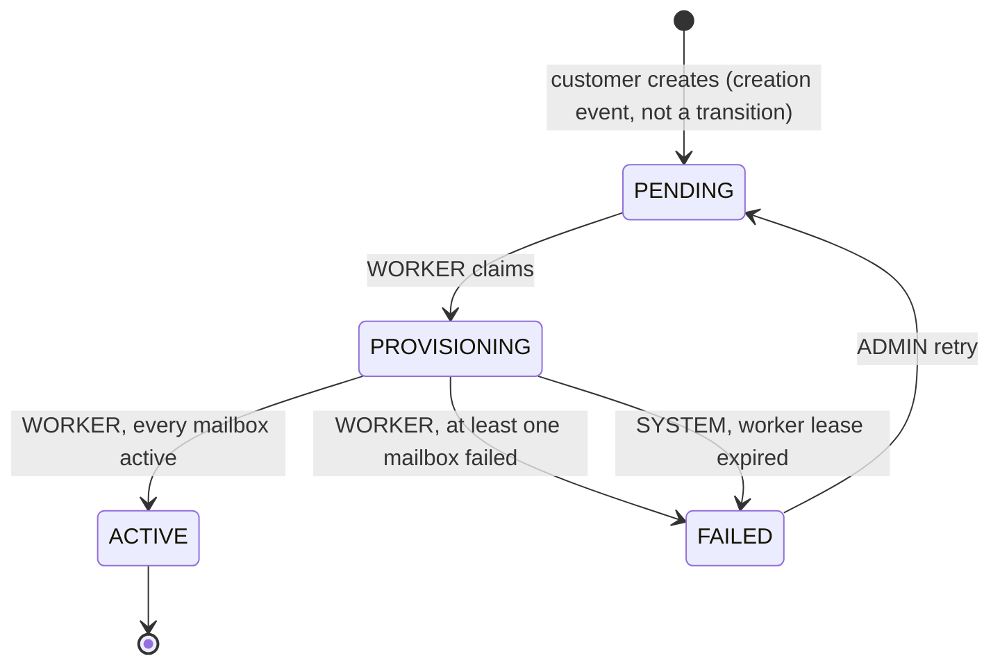

# Architecture

One Next.js application holds the UI and the HTTP API (route handlers). A second process, the
worker, is started from the same codebase. PostgreSQL is both the system of record and the job
queue.

```
Browser ──► Next.js (pages + /api route handlers) ──► services ──► repositories ──► PostgreSQL
                                                                                      ▲
Worker (tsx) ──► ProvisioningService ──► provider strategies (mock Google / Microsoft) │
        └───────────────────────────────► repositories ───────────────────────────────┘
```

## Order states



## A create request and a worker run

```mermaid
sequenceDiagram
    participant B as Browser
    participant R as POST /api/orders
    participant S as OrderService
    participant DB as PostgreSQL
    participant W as Worker
    participant P as Provider (mock)

    B->>R: domain, provider, count + Idempotency-Key
    R->>S: createOrder(viewer, body, key)
    S->>DB: find (user_id, key)
    alt same key, same payload
        S-->>R: existing order (200, replayed)
    else new key
        S->>DB: BEGIN; insert order + N mailboxes + creation event; COMMIT
        S-->>R: order (201)
    end
    R-->>B: OrderDetail DTO

    loop every poll interval
        W->>DB: sweep expired leases (SYSTEM -> FAILED)
        W->>DB: BEGIN; SELECT oldest PENDING FOR UPDATE SKIP LOCKED; PENDING -> PROVISIONING + event; COMMIT
        par up to PROVIDER_CONCURRENCY calls, no transaction open
            W->>P: provisionMailbox (with timeout)
            W->>DB: mailbox ACTIVE or FAILED
        and every heartbeat interval
            W->>DB: locked_at = now() WHERE locked_by = me
        end
        W->>DB: BEGIN; PROVISIONING -> ACTIVE/FAILED WHERE locked_by = me + event; COMMIT
    end
    B->>R: GET /api/orders/:id every 2 s while in progress
```

## Patterns

### 1. Layered architecture (route handler → service → repository)

- **What:** route handlers and server pages only guard, parse and call one service method;
  services hold the rules; repositories hold the queries.
- **Where:** `src/app/api/**/route.ts`, `src/app/(app)/**/page.tsx`, `src/server/services/`,
  `src/server/repositories/`.
- **Why:** each rule exists once and is testable without HTTP; the worker reuses the same services.
- **Rejected:** logic in route handlers or Server Actions with inline Prisma calls. Faster to write,
  but rules would be duplicated between the API, the pages and the worker.

### 2. Service layer with constructor injection and a composition root

- **What:** services are classes that receive their repositories and collaborators in the
  constructor. One function wires everything.
- **Where:** `src/server/container.ts` (`createContainer`, `getContainer`).
- **Why:** tests build their own container with a test database and fake providers
  (`tests/helpers/db.ts`, `tests/helpers/fake-providers.ts`).
- **Rejected:** a DI framework (overkill for a dozen classes) or module-level singletons imported
  everywhere (hard to swap in tests).

### 3. Repository pattern

- **What:** all database access sits behind small classes that accept an optional transaction
  client and contain no business decisions.
- **Where:** `src/server/repositories/user.repository.ts`, `order.repository.ts`,
  `mailbox.repository.ts`, `order-event.repository.ts`.
- **Why:** services compose repositories inside one transaction; raw SQL (`SKIP LOCKED`, the
  heartbeat, the sweeper query) stays in one place. The event repository can only append and read.
- **Rejected:** calling Prisma directly from services; queries and rules would mix and the
  append-only guarantee of the audit log would rest on discipline only.

### 4. State machine as a transition table, with a single writer of status

- **What:** allowed transitions and the actor allowed to make each one are data. Only the
  transition service changes `orders.status`, with a conditional update (`WHERE status = from`,
  and `locked_by = expected` when fencing).
- **Where:** `src/server/domain/order-state-machine.ts`,
  `src/server/services/order-transition.service.ts`. A compile-time check ties the domain types to
  the Prisma enums.
- **Why:** invalid transitions are impossible by construction, and concurrent writers get a 409
  instead of silently overwriting each other. The 64-case matrix is in
  `tests/unit/order-state-machine.test.ts`.
- **Rejected:** `if/else` status checks scattered across services, or XState (too heavy for four
  states and no client-side machine).

### 5. Unit of work: status change and audit event in one transaction

- **What:** the status update and the `order_events` insert happen in the caller's transaction;
  order creation writes the order, its mailboxes and the creation event together.
- **Where:** `OrderTransitionService.transition` and `recordCreation`,
  `OrderService.createOrder` and `retryOrder` in `src/server/services/order.service.ts`.
- **Why:** the audit log can never disagree with the order, and an order never exists without its
  mailboxes.
- **Rejected:** writing the audit log asynchronously (an event could be lost after the status
  changed).

### 6. Strategy and registry for providers

- **What:** a `MailboxProvider` interface with one class per provider; a registry returns the
  strategy for an order with an exhaustive switch.
- **Where:** `src/server/providers/mailbox-provider.ts`, `mock-mailbox.provider.ts`,
  `google-mock.provider.ts`, `microsoft-mock.provider.ts`, `provider-registry.ts`,
  `with-timeout.ts`.
- **Why:** the worker never knows which provider it talks to; a third provider is one class and one
  registry entry. Random and sleep are injected so tests are instant and deterministic.
- **Rejected:** `if (provider === 'google')` branches in the worker.

### 7. Queue and worker on PostgreSQL: lease, heartbeat, fencing, sweeper

- **What:** claim with `SELECT ... FOR UPDATE SKIP LOCKED LIMIT 1` and a transition in one short
  transaction; provider calls outside any transaction with bounded concurrency and a timeout; a
  heartbeat renews `locked_at` with the database clock; finalize is fenced on `locked_by`; a sweeper
  fails orders whose lease expired. Graceful shutdown on SIGINT/SIGTERM.
- **Where:** `src/server/services/provisioning.service.ts`, `src/server/worker/worker.ts`,
  `src/server/worker/main.ts`, queries in `src/server/repositories/order.repository.ts`.
- **Why:** two workers can never claim the same order, a crashed worker's order is recovered, and a
  slow worker cannot overwrite a decision made after its lease expired. Covered by
  `tests/integration/worker.test.ts`.
- **Rejected:** BullMQ + Redis (extra infrastructure), pg-boss (hides the mechanism being graded),
  `LISTEN/NOTIFY` alone (messages are lost while no worker listens).

### 8. Idempotency key with a request fingerprint, the database as arbiter

- **What:** the client sends `Idempotency-Key`; the server stores it with a SHA-256 of the
  normalised payload. Same key and payload replays (200), a different payload is a 422, and a
  concurrent duplicate that loses the unique-constraint race re-reads the winner.
- **Where:** `src/server/domain/request-hash.ts`, `OrderService.createOrder`,
  `src/server/db/prisma-errors.ts`; in the browser `src/features/orders/hooks/useIdempotencyKey.ts`
  reuses the key when the same payload is resubmitted after a failure.
- **Why:** double clicks, retries after a timeout and parallel requests create exactly one order
  (five concurrent requests are tested in `tests/integration/order-creation.test.ts`).
- **Rejected:** an in-memory or Redis key cache (lost on restart, and check-then-insert races).

### 9. DTOs and mappers with field whitelists and derived permissions

- **What:** services return DTOs built field by field; `canRetry` is computed with the state
  machine so components never re-implement rules.
- **Where:** `src/server/mappers/order.mapper.ts`, `src/server/mappers/user.mapper.ts`,
  `src/shared/types/order.dto.ts`.
- **Why:** `password_hash`, `request_hash`, `idempotency_key`, `locked_by` and `external_id` can
  never leak, and the UI shows Retry exactly when the server would accept it.
- **Rejected:** returning ORM objects to the client.

### 10. Error hierarchy mapped to one HTTP envelope

- **What:** `AppError` subclasses carry a code from a shared registry; one route wrapper maps them,
  Zod errors and unknown errors (generic 500, logged server-side) to `{ error: { code, message,
details? } }`.
- **Where:** `src/server/domain/errors.ts`, `src/shared/errors/error-codes.ts`,
  `src/server/http/route.ts`, `src/server/http/errors.ts`, `src/lib/api-client.ts` (typed
  `ApiError` in the browser).
- **Why:** consistent responses, no stack traces or SQL in responses, and the UI branches on codes.
- **Rejected:** a hand-written try/catch in every route handler.

### 11. Polling for live status

- **What:** the detail page polls every 2 s while the order is PENDING or PROVISIONING, pauses on
  hidden tabs and stops at a final state; lists refresh while a visible row is in progress.
- **Where:** `src/features/orders/hooks/useOrderPolling.ts`, `src/lib/use-auto-refresh.ts`.
- **Why:** simple, stateless on the server, and enough for a few-second refresh need.
- **Rejected:** WebSockets or Server-Sent Events (more moving parts and connection state for little
  gain here).

### 12. Design tokens for colours

- **What:** every colour lives in one JSON file and reaches components through the MUI theme as
  CSS variables, with light and dark schemes switched by a class on `<html>`.
- **Where:** `src/styles/themeColors.json`, `src/styles/theme.ts` (`tokens(theme)`),
  `src/styles/mui-custom-theme.d.ts`; an ESLint rule in `eslint.config.mjs` rejects colour
  literals outside `src/styles`; `tests/unit/theme-colors.test.ts` checks light and dark parity.
- **Why:** dark mode works everywhere with no flash and no hydration mismatch, and no component
  can drift from the palette.
- **Rejected:** hard-coded colours per component.

## Security notes

Session: HS256 JWT (`iss`, `aud`, `exp`) in an httpOnly `SameSite=Lax` cookie, `Secure` in
production; the user is re-read from the database on every request. Mutating requests must come
from the same origin and carry JSON (10 KB limit). Unknown emails are compared against a dummy
bcrypt hash so timing does not reveal accounts. Customers get 404, never 403, for other customers'
orders. Pages are protected in server layouts and pages (`src/server/auth/guards.ts`);
`src/proxy.ts` only forwards the path for the `next` parameter. Security headers and `noindex` are
set in `next.config.ts` and the root layout.

## Trade-offs and what I would do next

- Polling every 2 s is fine for a handful of viewers; with many, Server-Sent Events fed by
  `LISTEN/NOTIFY` would cut load.
- Idempotency keys never expire; a nightly job could clear keys older than a day.
- One order per worker process keeps the lease model simple; a worker could hold several leases if
  throughput mattered.
- Next: login rate limiting, a Content-Security-Policy with nonces, structured request logging
  with a correlation id, and real provider adapters behind the same interface.
